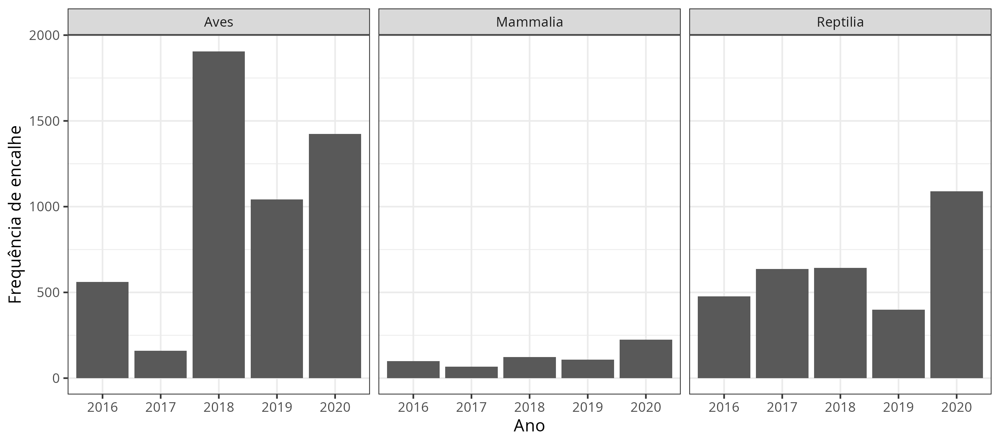
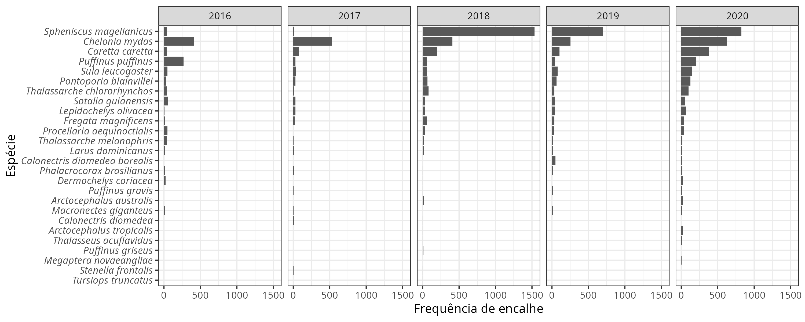
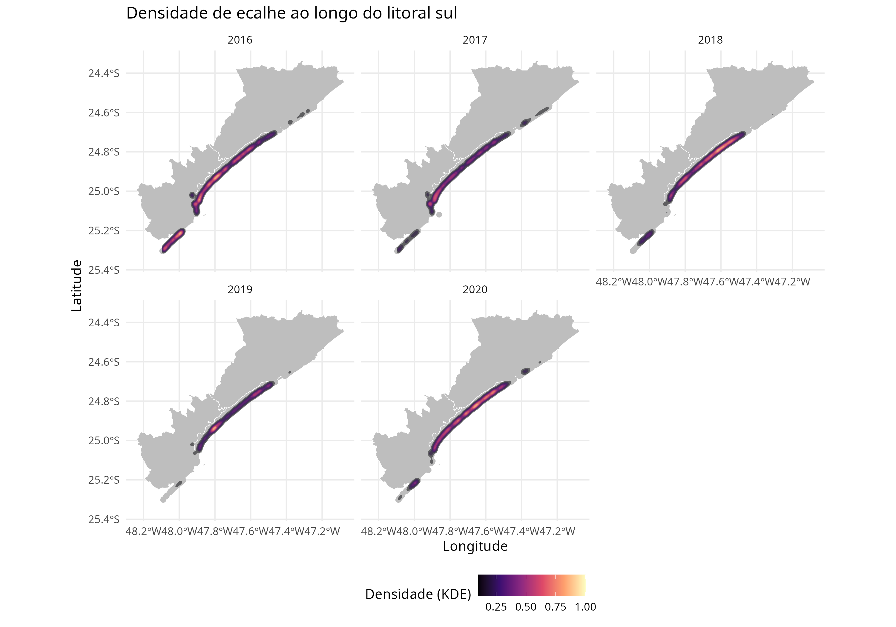

# Reunião de Análise Crítica - IPeC/PMP

Durante o ano de 2021, eu e alguns colegas do Instituto de Pesquisas Cananéia ([IPeC](https://ipecpesquisas.org.br/)) decidimos realizar uma Reunião de Análise Crítica (RAC) interna, em que os diferentes setores, apresentariam uma síntese de informações sobre seu setor referente ao último (2020) ano. 

A ideia era mostrar como tinha sido o trabalho durante esse período em cada um dos setores, e poder gerar discussões visando a melhoria da dinâmica de trabalho.

Neste repositório, apresento os códigos que utilizei para gerar as informações sobre o setor de Campo. No diretório [`Output`](https://github.com/alissondopona/rac-ipec-pmp/tree/main/Output) é possível vizualizar todos os gráficos utilizados.

Destaque para as tendências temporais de classes:

  

E também a frequência de encalhe por espécie:

  

E a densidade de encalhe no litoral sul ao longo dos 5 anos examinados:

  

